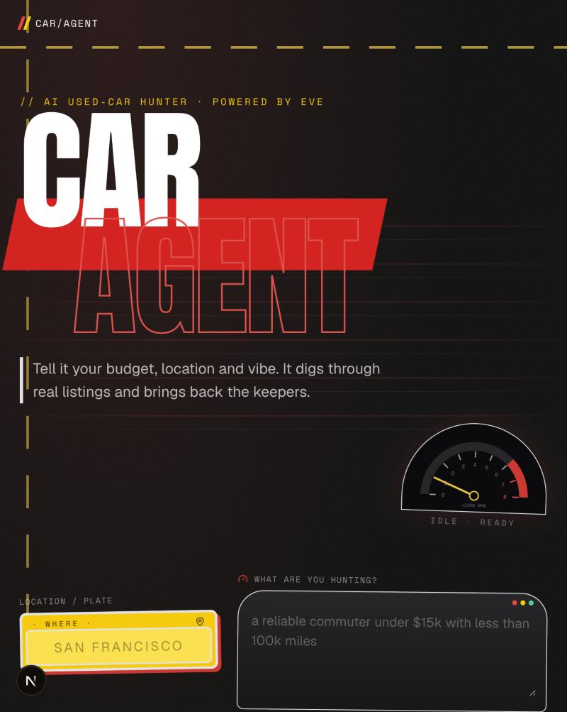
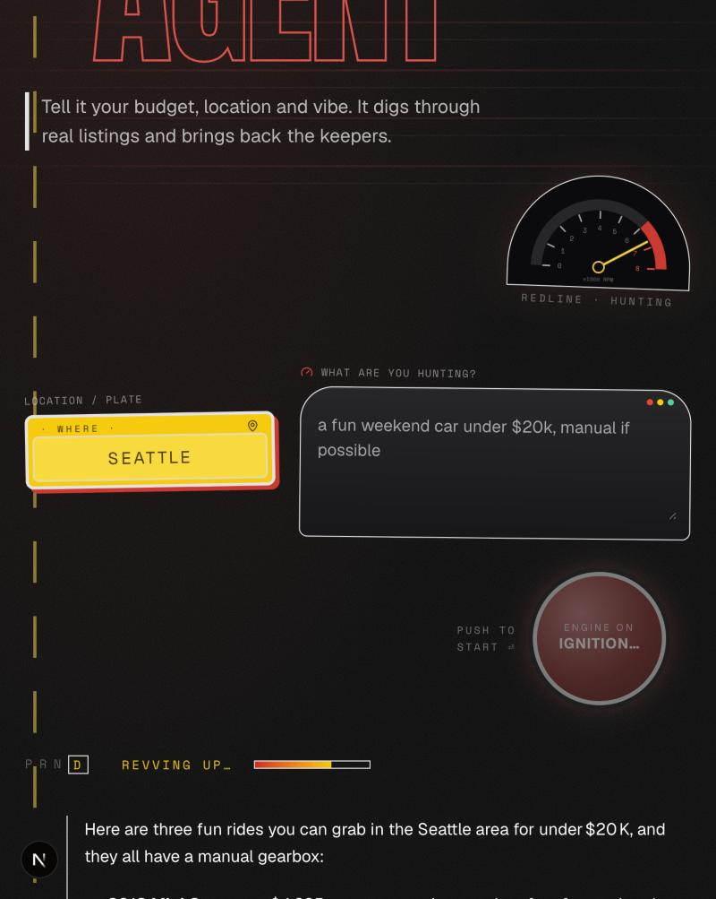
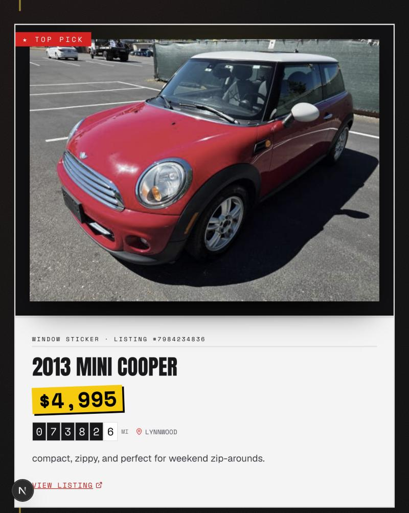
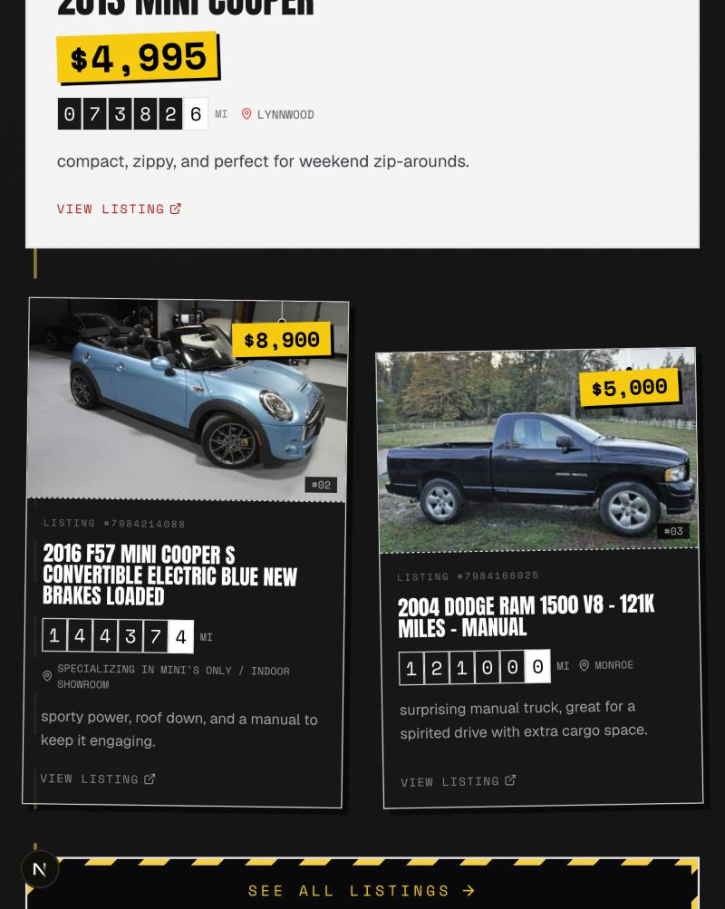

# Car Agent

An AI used-car hunter built with [eve](https://eve.dev). Tell it your budget, location and vibe, and it searches real listings and brings back the top three, each with a reason.

**Live demo → [car-agent-eve.vercel.app](https://car-agent-eve.vercel.app)**

<p align="center">
  
  
</p>
<p align="center">
  
  
</p>

## How it works

1. You enter a city and a plain-English request, like *"a fun weekend car under $20k, manual if possible"*.
2. The eve agent calls its `search_cars` tool, which turns the request into filters and searches Craigslist listings near that city.
3. It picks the best three listings, and the page shows them as cards with the photo, price, mileage, location and a one-line reason. "See all listings" opens the full search.

The agent only uses listings returned by the tool. It never makes up cars, prices or links.

| Path | What it does |
| --- | --- |
| `agent/instructions.md` | The agent's personality and process |
| `agent/tools/search_cars.ts` | Searches Craigslist by location, price and mileage |
| `agent/channels/eve.ts` | The HTTP channel the page talks to (open, so the demo works without a login) |
| `agent/agent.ts` | Model setup: Groq's free tier, or Claude through Vercel AI Gateway |
| `app/_components/car-agent.tsx` | The whole UI |

## Getting started

Requires Node 24.

```bash
npm install
```

Create `.env.local` with one of these keys:

```bash
GROQ_API_KEY=...          # free at console.groq.com (used first if set)
AI_GATEWAY_API_KEY=...    # Vercel AI Gateway, runs Claude Sonnet
```

Then run the app:

```bash
npm run dev
```

Open [localhost:3000](http://localhost:3000). The UI and the agent run together in one Next.js app.

## Deploy on Vercel

Import the repo on [vercel.com/new](https://vercel.com/new) with the Next.js framework preset and the root directory left as `./`. Add `GROQ_API_KEY` or `AI_GATEWAY_API_KEY` as an environment variable, then deploy. No other config is needed.

## Notes

- **Speed:** on Groq's free tier a search takes about 30 seconds. With AI Gateway it's a few seconds.
- **Listings:** cars come from Craigslist's public search. This is a demo; Craigslist's terms don't allow automated access for a real product.
- **Learn more:** [eve docs](https://eve.dev/docs) · [eve on GitHub](https://github.com/vercel/eve)

Built with eve on Vercel.
